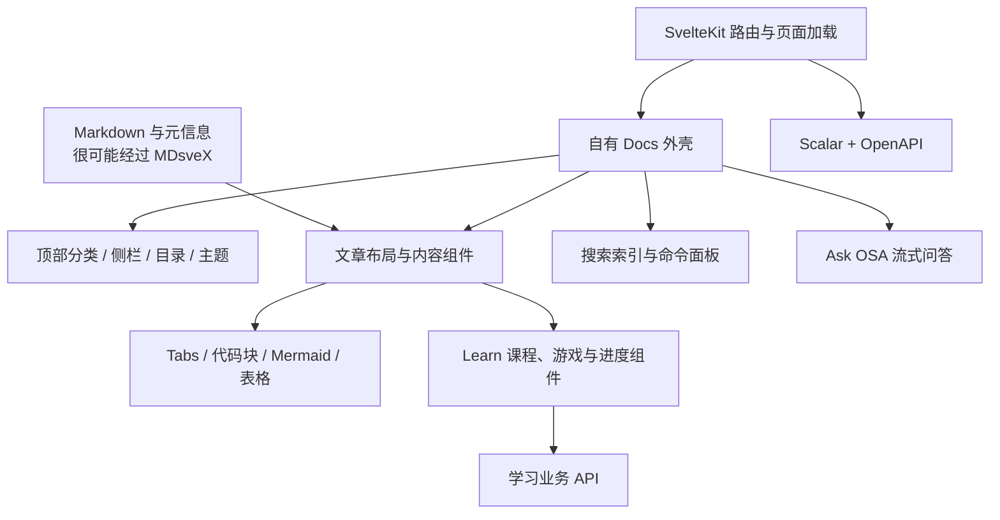

# MIOSA 文档站技术调查

调查日期：2026-11-09（America/Los_Angeles）  
入口：<https://miosa.ai/docs/learn/earn>

**判断：这是以 SvelteKit 为底座、加入自有文档外壳和业务组件的站点。内容处理很可能使用 MDsveX。Foundation 组件库已开源，完整文档站源码目前未找到。**

你对“Markdown 里嵌交互组件”的猜测接近实际。需要纠正的是技术方向：最值得追查的是 Svelte + MDsveX，而非直接认定为 React + MDX 或 Fumadocs。

本次实际使用 Craft Anything 0.5.0 的 `js-app-map` 和 `js-sources-restore`，并人工核对页面 HTML、公开 JS/CSS、机器可读文档、官方 GitHub 源码。所有关于交互的描述均来自代码静态分析，没有冒充浏览器实测。

## 1. 技术栈：哪些已经确认

| 层次            | 结论                                       | 依据与边界                                                                                                                      |
| --------------- | ------------------------------------------ | ------------------------------------------------------------------------------------------------------------------------------- |
| 组件框架        | **Svelte 5，已确认**                       | 发布资源明确向 `window.__svelte.v` 添加版本代际 `5`。不能据此确认精确补丁版本。                                                 |
| 应用框架        | **SvelteKit，已确认**                      | HTML 包含 `__sveltekit_*`、`kit.start`、节点编号和 `_app/immutable/` 资源；应用 manifest 包含文档路由。                         |
| 打包            | **Vite，已确认**                           | 发布代码包含 `__vite__mapDeps` 和按需加载的 chunk 图。                                                                          |
| HTML 渲染       | **先返回完整 HTML，再 hydration**          | 入口正文、导航和元信息已在初始响应里。仅凭缓存响应无法区分动态 SSR、预渲染，或混合模式。                                        |
| 内容编译        | **高置信推断为 MDsveX**                    | 普通文章导出 `default`、`metadata`，套共享 Svelte 布局，混用文章和组件，保留 Prism 风格的编译期高亮。尚无生产构建配置直接证明。 |
| 设计系统        | **MIOSA Foundation，公开 MIT 源码**        | 官方组件文档说明 `$foundation` 别名与内部目录；公开仓库有组件实现。不能保证公开版本与线上内部副本完全一致。                     |
| 无障碍基础组件  | **公开 Foundation 使用 Bits UI**           | Modal、Select、Menu、Tabs、Popover 等源码直接导入 `bits-ui`。不能把它扩大成“文档站的每个控件都由 Bits UI 实现”。                |
| 样式            | **Tailwind 与大量 Svelte scoped CSS 并用** | 线上全局 CSS 有 Tailwind layer/变量；文档外壳和正文有独立 scoped CSS、CSS custom properties。公开 Foundation 声明 Tailwind v4。 |
| 图标            | **Lucide**                                 | DOM 有 `lucide-*` 标记，编译代码有 Lucide 图标节点；Foundation 声明 `lucide-svelte`。                                           |
| 字体            | **文档界面使用 Geist / Geist Mono**        | 文档样式内有本地 WOFF2 的 `@font-face`。组件规范里出现的 Inter 不应直接当成线上文档字体。                                       |
| 动态代码高亮    | **Shiki，已确认**                          | 懒加载 `createHighlighter`，使用 JavaScript regex engine 和浅色/深色主题。                                                      |
| 文章代码高亮    | **Prism 风格的预生成标记**                 | 普通文章包含 `language-*`、`token keyword` 等 markup；不能据此声称浏览器运行了 Prism。                                          |
| 图表            | **Mermaid + 自定义交互包装**               | 动态加载、主题初始化、渲染和放大控件均可在发布代码中定位。                                                                      |
| 交互式 API 文档 | **Scalar + OpenAPI，已确认**               | `/docs/api` 调用 `createApiReference`，读取 `/openapi.yaml`。                                                                   |
| 搜索            | **自定义浏览器端词法搜索**                 | 代码里直接实现索引、模糊匹配、打分和分组，读取 `/docs-search.json`。                                                            |
| AI 文档问答     | **自有 HTTP/SSE 客户端**                   | 请求 `/api/docs/ask`，附页面上下文、历史消息并处理流式事件。后端模型与检索实现未知。                                            |
| 网络边缘        | **Cloudflare 可确认**                      | 响应头有 Cloudflare 标记，文档另公开 Worker 备用入口。不能仅据此确认主站源站部署形态。                                          |

技术依据：[线上入口](https://miosa.ai/docs/learn/earn)、[Svelte 版本标记](https://miosa.ai/_app/immutable/chunks/DsnmJJEf.js)、[应用 manifest](https://miosa.ai/_app/immutable/entry/app.Bx92bmMT.js)、[Foundation package.json](https://github.com/Miosa-osa/foundation/blob/main/package.json)。资源文件名包含构建哈希，将来发布后可能失效。

## 2. 为什么像 Fumadocs，却又明显不同

它们共享成熟文档产品常见的界面语言：顶部分类、树状侧栏、正文、右侧目录、搜索面板、代码示例、上一页/下一页和 Markdown 复制。这种相似可以通过功能与布局独立形成，不能证明代码继承关系。

Fumadocs 的文档布局实现属于 React 生态；此站的活动文档实现是 Svelte 编译产物。调查没有找到足以认定它直接使用 Fumadocs、修改某个 Fumadocs 主题，或采用另一套完整开源文档框架的证据。[Fumadocs 布局源码](https://github.com/fuma-nama/fumadocs/blob/dev/packages/radix-ui/src/layouts/docs/index.tsx)

更符合证据的结构是：

这里真正形成产品差异的是文档之外的学习功能，以及围绕普通文章加上的交互层。

## 3. MDX、MDsveX 与 Markdown 导出

**MDX 的思路判断正确，具体实现更像 MDsveX。** MDsveX 支持在 Markdown 中使用 Svelte 组件，并支持 frontmatter、布局和编译期高亮；这些特征与此站文章的输出一致。[MDsveX 官方文档](https://mdsvex.pngwn.io/docs)

支持这一推断的组合证据有四个：

1. 文章模块除了组件，还导出 `metadata`，其中有标题和描述。
2. 多篇文章通过同一个共享 Svelte 布局渲染。
3. 正文中的代码已经变成带高亮标记的 HTML。
4. 文章间可直接插入 Tabs、提示框、图表和 Learn 业务组件。

仍然未知的是原始扩展名究竟为 `.md`、`.svx`，还是有额外生成步骤；remark/rehype 插件和精确版本也无法从这些产物还原。自定义编译器同样可能生成类似结果，因此报告保留“高置信推断”。

另一个关键区别：**站点能返回 `.md`，不等于浏览器靠 Markdown 解释器实时渲染整篇文章。** 当前浏览器收到的是已经编译的 Svelte 页面；Markdown 是另一个公开输出。入口 HTML 声明了 Markdown alternate，复制菜单也会请求对应 `.md` 地址。[入口 Markdown](https://miosa.ai/docs/learn/earn.md)、[文章编译产物示例](https://miosa.ai/_app/immutable/chunks/CSsGFIpk.js)

可以学习这种“一份内容，多种消费入口”的组织方式，但目前不能证明所有输出都由同一个构建任务生成。

## 4. 文档外壳与组件库分别负责什么

公开 Foundation 是组件与设计系统。站点自己的说明将它接入内部 Svelte 应用，通过 `$foundation` 别名使用。公开仓库包括按钮、表单、卡片、对话框、菜单和 Tab 等基础实现。[官方 Foundation 文档](https://miosa.ai/docs/ui-components/foundation)、[公开仓库](https://github.com/Miosa-osa/foundation)

文档外壳另有一批专用行为，主要证据位于 [Docs layout chunk](https://miosa.ai/_app/immutable/nodes/29.Bm2L_aO_.js)：

- **导航树**：由带 `label`、`slug`、`items` 等字段的数据渲染，展开状态写入 `docs-nav-open`；当前路径也参与展开与选中计算。
- **侧栏调整**：代码将宽度限制在 220–380px，默认 260px；支持拖动和键盘，宽度与折叠状态写入 `docs-sidebar`。
- **移动端导航**：根据断点切成抽屉，并有焦点与关闭行为。
- **主题**：包含 system、light、dark、glass、glass-dark，由 CSS 变量与共享状态控制。
- **正文目录**：收集可见的 h2/h3，滚动时通过 `requestAnimationFrame` 更新当前标题，并处理折叠内容变化。
- **页面操作**：复制 Markdown、在其他 AI 产品打开、问 OSA，以及上一篇/下一篇。

普通正文还会在挂载后增强：为 `<pre>` 增加语言与复制按钮，为表格增加滚动容器，并依据列数、内容设置响应式表现。[正文布局实现](https://miosa.ai/_app/immutable/chunks/BhMgSx7r.js)

这解释了它为什么在文章层面比常见文档主题更“像应用”：编译好的文章只是基础，外层仍在分析与增强正文结构。

如果你说的 shell 库是指整套页面壳，当前证据指向自有 Svelte 组件与状态。若指终端模拟器，文档里的 Shell 代码块主要是文本、高亮和复制；没有证据把它们认定成 xterm.js 终端。MIOSA 另有面向用户的嵌入式终端组件，那是不同产品面。[客户侧组件仓库](https://github.com/Miosa-osa/miosa-components)

## 5. 搜索的核心逻辑

搜索并非只有一个弹窗样式。发布代码里有独立的词典、候选扩展与排序实现。[搜索实现](https://miosa.ai/_app/immutable/chunks/DiyXU3XB.js)

静态代码显示的处理过程是：

1. 页面空闲时预取索引，也允许打开面板时加载。
2. 把页面、标题和章节建立为搜索条目。
3. 对查询分词，加入前缀和编辑距离匹配。
4. 根据标题、路径、描述、正文等位置累计权重，再结合短语匹配调整。
5. 限制同一页面的章节占位，按类别组织结果。
6. 保存最近访问项，并提供 Cmd/Ctrl+K、方向键、Enter、Escape 等操作。

索引是一个可直接检查的 JSON：页面字段包含 URL、标题、描述、正文与章节。此次获取的索引包含 427 个页面条目，原始响应约 2.01MB；它与路由 manifest 的条目数口径不同，不能据此评价完整性。[搜索索引](https://miosa.ai/docs-search.json)

复用它的产品思路很有价值，但不必直接复制其搜索算法。若未来文档以中文为主，要重新选择分词策略：当前这段实现主要按 ASCII 字母数字切词，不能原样当成通用中文全文搜索。

## 6. “参数化文档”其实有几种不同机制

### A. 示例语言联动：已经确认

教程中有 `syncKey="lang"`。Tabs 组件维护一个模块级 Map，为每个同步键保存 Svelte store。切换一个语言标签后，订阅同一键的其他示例随之切换。[教程产物](https://miosa.ai/_app/immutable/chunks/Bh9sT_Bc.js)、[Tabs 实现](https://miosa.ai/_app/immutable/chunks/D5K_cUoD.js)

这不需要大型表单框架；实质上是“同一偏好名对应一个共享状态”。这段机制本身没有证明会把语言选择永久保存到 localStorage，不应与页面中其他持久化控件混为一谈。

### B. API 参数与请求界面：已经确认

交互式 API 页将 OpenAPI 交给 Scalar，生成 API 阅读与尝试界面。站点配置包含 Kepler 主题、默认深色等选项。[Scalar 挂载实现](https://miosa.ai/_app/immutable/chunks/e_zos4Kt.js)、[OpenAPI](https://miosa.ai/openapi.yaml)、[Scalar 官方接入文档](https://scalar.com/products/api-references/integrations/html-js)

页面说明自身主要面向 allowlisted Sandbox V1 surface。因此不能把这个交互页等同于全部平台 API 文档，也不能推断每篇手写 API 文章都由 OpenAPI 自动生成。

### C. 学习内容由业务数据驱动：已经确认

Earn 客户端会读取公开课程配置与个人状态，还定义了测验、观看会话等接口。页面可以据此展示轨道、额度、进度和下一步。[学习业务客户端](https://miosa.ai/_app/immutable/chunks/Bm3EP5xm.js)

小游戏代码另有自己的状态、交互与本地记录。游戏过程、练习记录、正式测验和奖励状态是不同层面的东西，不能把 localStorage 中的记录当成获得积分的依据。[游戏页面实现](https://miosa.ai/_app/immutable/chunks/BbxGbdr_.js)

### D. 任意文档变量替换：尚未确认

例如“填写 workspace、API key、region，所有示例自动代入”，当前检查没有找到可确认的通用文档变量系统。若这是你想学习的能力，应作为自己的小功能设计，而不能说 MIOSA 已经用某个现成库实现了它。

## 7. Ask OSA、图表与代码块

Ask OSA 将问题、当前页面和可选历史消息提交给 `/api/docs/ask`，使用 SSE 接收元信息、token、错误和完成事件，并处理停止、限流与验证状态。可以学习它如何把问答与当前文章上下文连接起来；从前端不能确认它使用哪个模型、向量库，或哪种检索框架。[问答客户端所在 chunk](https://miosa.ai/_app/immutable/nodes/29.Bm2L_aO_.js)

Mermaid 包装不止“把源码渲成 SVG”：代码还处理主题、放大，以及部分 flowchart 的拆分呈现。[图表与 Tabs 组件](https://miosa.ai/_app/immutable/chunks/D5K_cUoD.js)

动态代码高亮使用 Shiki，按需加载 highlighter，并准备浅色和深色主题。它与文章里预生成的 Prism 风格高亮并存。[高亮工具](https://miosa.ai/_app/immutable/chunks/DTkrhSdY.js)

这说明站点存在不同年代或不同需求的内容路径。学习时应先选一种满足自己需求的高亮方案；没有必要为了模仿而同时引入两种。

## 8. 哪些开源，哪些还没有找到

| 内容                   | 调查结果                                   | 怎样使用                                                              |
| ---------------------- | ------------------------------------------ | --------------------------------------------------------------------- |
| MIOSA Foundation       | 官方公开仓库，MIT                          | 学组件结构、样式变量、Bits UI 封装；按需取用。                        |
| MIOSA 客户嵌入组件     | 官方公开仓库                               | 面向 preview、terminal 等嵌入需求，与文档外壳分开理解。               |
| 完整 Docs shell        | 未在此次返回的 34 个官方公开组织仓库中找到 | 不能交付一个已验证的完整 clone 地址。也不能据此证明其他地方绝对没有。 |
| Markdown 文档          | 公开读取                                   | 用于内容分析与结构学习，不代表站点实现代码开源。                      |
| 搜索/文档索引、OpenAPI | 公开读取                                   | 可检查机器接口和内容组织方式。                                        |
| Learn 后端、问答后端   | 当前未找到可确认源码                       | 仅分析前端契约，不推测内部数据库与实现。                              |

仓库入口：[Foundation](https://github.com/Miosa-osa/foundation)、[miosa-components](https://github.com/Miosa-osa/miosa-components)、[官方组织](https://github.com/Miosa-osa)。此次读取的 Foundation commit 为 `55a625547694de240f8631c11bd74ead525a38e9`。

公开 Foundation 的 README、内部组件文档与线上 Docs 的设计描述存在差异。它们可以证明技术家族与组件来源，不能证明“下载公开仓库就能跑出这个文档站”。

机器入口还包括：[llms.txt](https://miosa.ai/llms.txt)、[docs-index.json](https://miosa.ai/docs-index.json)、[llms-full.txt](https://miosa.ai/llms-full.txt)。本次读取了前两者；后者由 llms.txt 声明，未下载其全文。

## 9. 用 craft-anything 的 Study，还是其他能力

**本次目的适合 Deep 下的 JS 静态分析，再读公开源码。** 官网的 Study 是 Study → Build → Check 流程中的调查阶段，不是本机另有一个独立的 `study` skill。[Craft Anything 官方说明](https://github.com/storytold/craft-anything)

| 目标                           | 合适方式                                                                     |
| ------------------------------ | ---------------------------------------------------------------------------- |
| 识别依赖、接口、状态与模块关系 | `js-app-map`，结合人工追踪 import 和代码。                                   |
| 阅读压缩后的 JS                | `js-sources-restore`。它能整理代码，但不会凭空恢复原变量名和缺失的原始文件。 |
| 了解已有开源库的实现           | 直接阅读官方源码，优先于逆向。                                               |
| 验证点击、拖动、响应式和动画   | 浏览器观察、截图、walkthrough；这是静态分析之外的验证。                      |
| 以后制作自己的版本             | 再进入构建阶段，明确需要保留的交互。                                         |

此次没有启动 rebuild，也没有运行测验、领取积分、调用收费问答或使用账户。分析模式仅通过 CLI 的 `--deep` 用于本次调查，没有把全局 MCP 默认模式改成 Deep。

Craft 记录中，最终站点静态映射证据 ID 为 `ev_2f5351559ee916cca4bfdf7129f14b91cba540eb7bdf9fd3cee0de218dd058db`；Foundation 映射证据 ID 为 `ev_e9842433298f5001f6fc7d25a871ec7eb046ec0ccf33582f382481850c4b9ff5`。完整证据 ID 与检查边界见同目录 JSON。工具图存在未读取依赖，不能声称整站分析完整覆盖。

## 10. 建议怎样学过来

我建议先学清楚三层：**内容如何编译，文档壳如何组织，业务组件怎样嵌进去。** 这比寻找一个能一键还原站点的主题更接近实际。

1. **搭最小文档骨架**：SvelteKit + MDsveX，做标题元信息、侧栏、正文、目录和深浅主题。先用普通 CSS 与少量 token，Foundation 按需参考。
2. **做三类内容组件**：联动语言 Tabs、可复制代码块、可放大的 Mermaid。先保证作者容易写，再加表现效果。
3. **建立内容出口**：HTML、Markdown、页面索引与搜索索引。尽量从共同元信息生成，避免手工维护多份标题和路径。
4. **接入 API 规范**：已有 OpenAPI 就用 Scalar。手写指南继续负责场景、解释与教程。
5. **最后添加产品化能力**：需要时再做搜索偏好、问答、课程进度与游戏；这些都不应成为基础文档阅读的前置依赖。

如果最终使用 React，MDX + Fumadocs 仍能承载类似产品；只是那属于采用另一套实现重建这些能力。若希望沿着 MIOSA 的实现方式学习，起点应是 **SvelteKit + MDsveX + 按需参考 Foundation + Scalar**。

目前还缺少的证据是：生产文档编译配置、完整 Docs shell 源码、后端问答实现，以及浏览器交互实测。这些不影响上述底层框架与公开依赖结论，但限制了对精确实现和完整复现的承诺。
