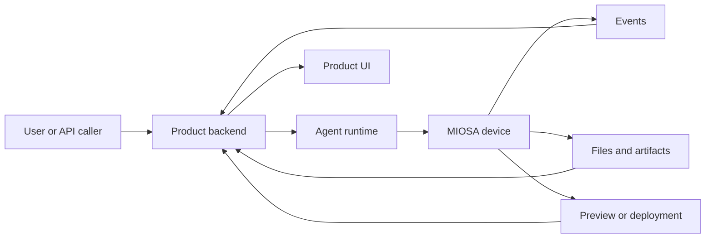

MIOSA lets builders create products where agents do real work in cloud devices.
The product model is deliberately small:

```text
Agent + Device + Tools + Run stream + Artifacts + Credits
```

That model supports simple one-shot commands, generated app builders, browser
automation, artifact workspaces, 24/7 company operators, white-label SaaS
backends, and multi-agent fleets.

使用此页面作为基于 MIOSA 构建的产品的规范词汇。

---

## 核心原语

|原始|意义|拥有者 |
|---|---|---|
|智能体| The worker identity: instructions, runtime, model, tools, memory, policy |您的产品或 MIOSA |
|运行时| The implementation that reasons and acts: OSA, Codex, Claude Code, Hermes, Pi, custom |智能体配置|
|设备|工作发生的机器：沙箱、计算机或本地设备 |米奥萨 |
|运行| A prompt dispatched to an agent on a device |您的产品和 MIOSA |
|会议| A long-lived run that can receive more tasks |智能体运行时 |
|工具|功能：文件、执行、浏览器、连接器、部署、工件、MCP |运行时和策略|
|活动 |工作流式记录：工具调用、命令输出、文件更改、屏幕截图 | MIOSA 流 |
|神器|持久的输出：文件、图像、PDF、DOCX、报告、预览、应用程序 URL | MIOSA 存储 |
|快照| Saved filesystem/device state for resume, fork, or rollback |米奥萨 |
|学分|模型使用、设备运行时间、工具、存储和托管的计量单元 |帐单 |

> **注意：不要将运行时与设备混淆**
>
> MIOSA 智能体是推理/运行时层。设备就是工作的地方
> 执行。沙箱有一个执行者，但该执行者不是产品智能体。

---

## 边界



Your product backend decides:

- 用户是谁
- what workspace, project, and budget apply
- 应该运行哪个智能体
- which runtime should power the agent
- which device the agent can use
- which tools and connectors are allowed
- which actions require approval
- how events appear in your UI

MIOSA 提供：

- 沙箱生命周期
- 计算机生命周期
- 本地设备配对
- filesystem and exec APIs
- browser/desktop execution
- 预览和路由
- snapshots and persistence
- artifacts and downloads
- 部署和 Docker 主机
- 事件流
- 信用计量挂钩

---

## 产品类别

- **应用程序构建器**：智能体在持久沙箱内编写代码，启动预览，修复
  错误、创建工件并发布完成的应用程序。
- **工件工作区**：智能体创建 PDF、DOCX 文件、图表、图像、报告、ZIP 和
  HTML 预览，然后存储每个输出的版本历史记录。
- **浏览器操作员**：智能体使用计算机单击、键入、登录、填写表格、检查页面，
  capture screenshots, and verify workflows.
- **虚拟设备产品**：用户和智能体共享持久设备，包括文件、浏览器状态、作业、
  预览、连接的应用程序和可恢复的会话。
- **智能体公司平台**：协调器将工作委托给跨沙箱的部门智能体，
  computers, connectors, and scheduled jobs.
- **白标 SaaS 后端**：您的平台将用户的提示路由到 MIOSA 资源，同时
  保留您自己的工作区、项目和计费模型。

---

## 产品堆栈

大多数 MIOSA 支持的产品具有相同的层：

|层|责任|
|---|---|
|产品界面|聊天、任务、文件、工件、预览、批准、使用情况 |
|产品API |授权、租赁、工作空间/项目映射、预算、政策 |
|协调员|智能体选择、运行时路由、设备分配、队列 |
| MIOSA 设备 |沙箱、计算机、本地设备、预览、快照 |
|工具层|文件、执行、浏览器、连接器、出口、部署、MCP |
|事件流 |实时进度、标准输出、屏幕截图、工件、错误 |
|帐单 |按型号、设备、连接器、存储、部署划分的积分 |

The product UI should make the run visible. Users should see what the agent is
doing, not only a final chat answer.

推荐窗格：

- 聊天或任务输入
- 当前计划
- 实时工具调用
- 命令输出
- file tree or artifact list
- 预览/浏览器面板
- 批准
- 使用的积分
- 最终输出

---

## 规范运行形状```typescript
type AgentRun = {
  id: string;
  tenantId: string;
  workspaceId: string;
  projectId?: string;
  userId: string;
  agentId: string;
  runtime: "osa" | "codex" | "claude-code" | "pi" | "hermes" | "custom";
  device: {
    type: "sandbox" | "computer" | "local";
    id: string;
  };
  prompt: string;
  status: "queued" | "running" | "waiting_for_approval" | "failed" | "completed";
  approvalPolicy: "auto" | "confirm-risky" | "manual";
  idempotencyKey: string;
};
```

每次运行都应该：

- 一个业主工作空间
- 一个发起用户或服务帐户
- 一名选定的智能体人
- 一台主设备
- 一个幂等键
- 类型化的事件流
- 信用分类账记录
- 创建资源后失败的恢复路径

---

## 事件流

事件流让产品给人一种生机勃勃的感觉。

|活动 |目的|
|---|---|
| `run.queued` |请求已接受并等待执行 |
| `run.started` |运行时和分配的设备|
| `agent.message.delta` |助理文本流式传输到 UI |
| `plan.updated` |智能体创建或更改了任务计划 |
| `tool.started` |工具、MCP、连接器或设备操作已开始 |
| `tool.completed` |工具完成并包含结果元数据 |
| `command.output` |来自 exec 的 stdout/stderr 块 |
| `file.changed` |文件创建/更新/删除/重命名 |
| `preview.ready` |实时服务器 URL 已准备就绪 |
| `browser.screenshot` |计算机/浏览器图像捕获 |
| `artifact.created` |提供持久输出 |
| `approval.required` |需要人工批准|
| `credits.estimated` |危险行为的预期成本|
| `credits.charged` |已提交计量条目 |
| `deployment.ready` |公共网址直播 |
| `run.failed` |带有恢复指令的类型故障 |
| `run.completed` |最终答案和输出已准备就绪 |

不要构建一个直到最后都隐藏所有这些的产品。可见流
这是用户信任智能体正在工作的方式。

---

## 计费内容

积分应按资源类别计量：

|类别 |示例 |
|---|---|
|型号| OSA/模型令牌、外部模型调用、托管智能体运行时 |
|设备运行时 |沙箱 CPU/RAM 时间、计算机时间、本地设备中继 |
|模具|浏览器操作、连接器令牌请求、Refero 设计研究、网络搜索 |
|存储|工件、快照、持久工作区存储、日志 |
|部署| MIOSA 部署、Docker 主机、域、永远在线的应用程序 |

这意味着用户不需要了解每个基础设施细节。
他们购买积分；归功于电力智能体在设备上进行的实际工作。

---

## 另请参阅

- [工作流程模式](/docs/guides/agent-workflow-patterns)：从简单到复杂的示例：一次性运行、沙箱构建、浏览器工作、团队和车队。
- [运行时路由](/docs/guides/agent-runtime-routing)：OSA、Codex、Claude Code、Hermes、Pi 和自定义运行时如何附加到设备。
- [信用计量](/docs/platform/agent-credit-metering)：计量模型使用情况、设备运行时间、工具、存储和部署。
- [构建智能体公司平台](/docs/guides/build-agent-company)：将 Polsia、CoFounder (coFounder.co)、Nebula、Heuresis 和 AgentFounder 风格的产品映射到 MIOSA。
